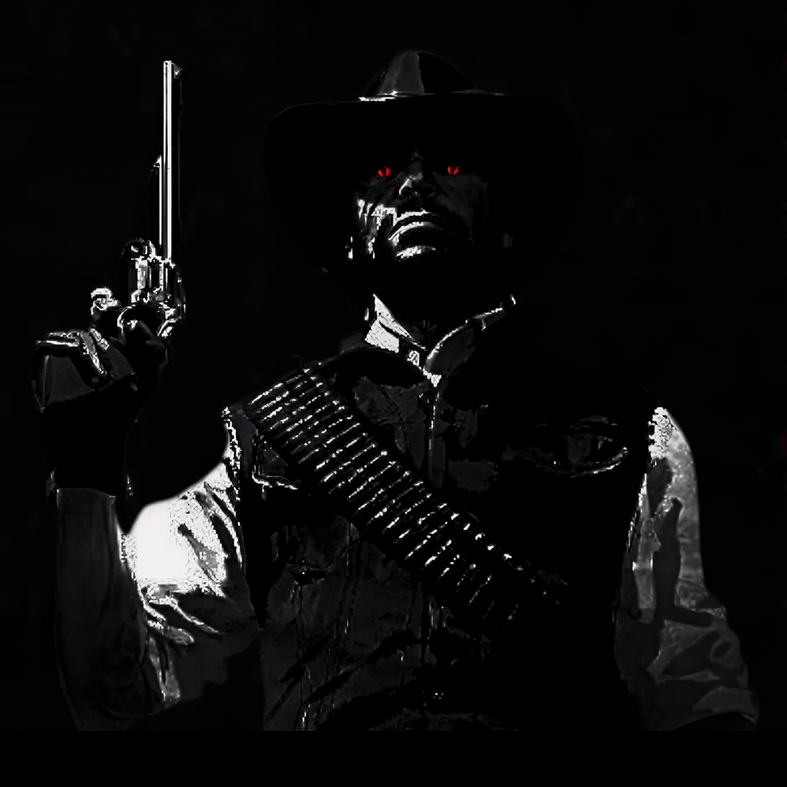

<!-- Upload your profile image to the same repo as: assets/profile.jpg -->

```cpp
// Queen's Gambit
// 1.d4 d5 2.c4

#include <iostream>
int main() {
    std::cout << "d4 d5 c4\n";
    std::cout << "I just want the world to know I was here\n";
    std::cout << "That I mattered.\n";
    return 0;
}
```


<br/><br/>



```
 ╔═══════════════════════════════════════════╗
 ║   NAME:     TheEdward  "ShotEddie"        ║
 ║   CITY:     Night City                    ║
 ║   CRIME:    8,000 hours of Fortnite       ║
 ║   REWARD:   $5,000                        ║
 ╚═══════════════════════════════════════════╝
```

</div>

## 🤠 The Outlaw

- 🔫 **Job:** Outlaw & Mercenary for hire
- 🏙️ **Hideout:** Night City
- 🪦 **Motto:** *I was here. I mattered.*

## 🎒 Saddlebag

<div align="center">


<br/>

[](https://instagram.com/shoteddie)
[](https://youtube.com/@shoteddie)


</div>
